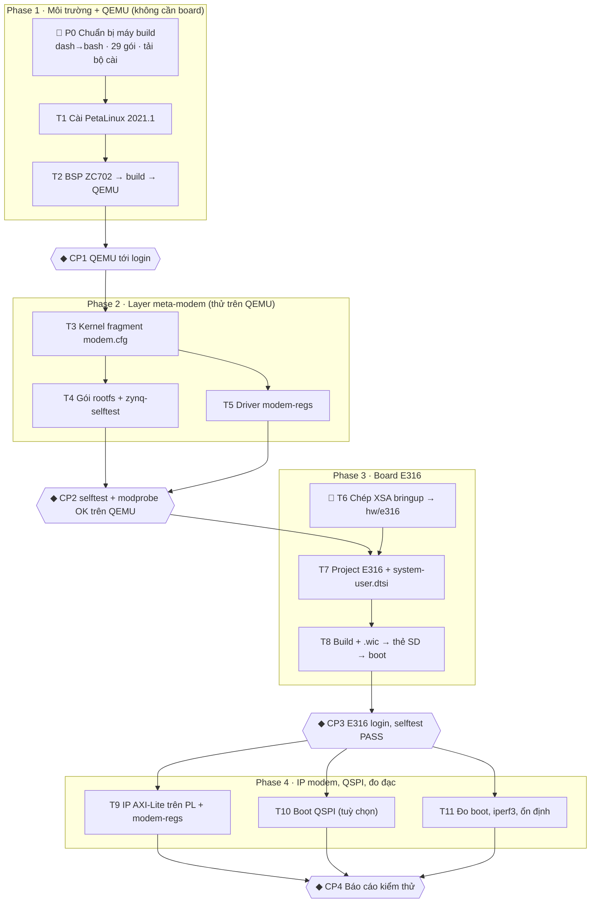

# Lộ trình PetaLinux cho E316

Các bước dựng Linux nhúng cho modem vệ tinh trên ANTSDR E316: thứ tự làm, cần cài gì, cần học gì cho từng bước. Chi tiết kỹ thuật từng bước build/boot: [quy-trinh-xay-dung.md](quy-trinh-xay-dung.md). Task và tiêu chí nghiệm thu: [../tasks/todo.md](../tasks/todo.md).

| | |
|---|---|
| Công cụ | PetaLinux 2021.1, Vivado 2021.1 (máy Windows), Yocto gatesgarth |
| Máy build | Ubuntu 20.04.6, 12 luồng, 15 GB RAM, ~419 GB trống |
| Cập nhật | 23/10/2026 |

## 1. Sơ đồ các bước

Ký hiệu: 👤 người dùng làm · không ký hiệu = Claude làm (hỏi trước khi chạy) · ◆ checkpoint người dùng duyệt.



**Đường găng:** P0 → T1 → T2 (lần build đầu 1–2 giờ, cần mạng) → T7 → T8. T6 không chặn vì XSA E316 bản 2021.1 đã có trong `_ZynQ_Study/`.

## 2. Cần cài

| Nơi | Trạng thái | Cần gì |
|---|---|---|
| Máy build (Ubuntu 20.04.6) | **chưa xong** | `/bin/sh` đang là dash → đổi sang bash; thiếu **29 gói** host; chưa có `/opt/pkg`. Đã có: kiến trúc i386, locale `en_US.UTF-8` |
| Tải từ AMD (cần tài khoản, mục Archive 2021.1) | **chưa có** | `petalinux-v2021.1-final-installer.run`; `xilinx-zc702-v2021.1-final.bsp`; (tuỳ) Hardware Server 2021.1 nếu cần JTAG từ máy build |
| Máy Windows | đã có | Vivado/Vitis 2021.1 — dùng ở T9 |
| Phần cứng | đã có | ANTSDR E316, cáp USB Type-C (console UART1 115200), microSD ≥ 8 GB + đầu đọc, cáp mạng cùng dải 192.168.1.x, jumper boot SD |

Lệnh cài cho P0 (một lần, cần sudo). Danh sách gói đã kiểm bằng `dpkg-query` và chạy thử `apt-get -s` ngày 23/10: không lỗi.

```sh
# 1. /bin/sh → bash (chọn "No")
sudo dpkg-reconfigure dash

# 2. 29 gói host còn thiếu theo UG1144 2021.1 (python→python2, pylint3→pylint trên 20.04)
sudo apt update
sudo apt install -y gawk python2 net-tools libncurses5-dev tftpd libssl-dev flex bison \
  git-core diffstat chrpath xterm autoconf libtool texinfo gcc-multilib automake screen pax \
  python3-git python3-jinja2 libegl1-mesa libsdl1.2-dev pylint libtinfo5 zlib1g:i386

# 3. Tiện ích tra cứu: console serial, dtc, mkimage/dumpimage
sudo apt install -y picocom device-tree-compiler u-boot-tools

# 4. Thư mục cài PetaLinux cho user thường; quyền mở /dev/ttyUSB0
sudo mkdir -p /opt/pkg/petalinux/2021.1 && sudo chown -R "$USER": /opt/pkg
sudo usermod -aG dialout "$USER"   # đăng xuất/nhập lại để có hiệu lực
```

## 3. Từng bước: làm gì, học gì, xong khi nào

### Phase 1 — Môi trường + QEMU

**P0 · Chuẩn bị máy build** 👤
- **Làm:** chạy khối lệnh ở mục 2; tải bộ cài + BSP ZC702 2021.1.
- **Học:** UG1144 v2021.1 chương 2 “Setting Up Your Environment”.
- **Xong khi:** `readlink -f /bin/sh` ra `/usr/bin/bash`; có đủ 2 file tải về.

**T1 · Cài PetaLinux 2021.1**
- **Làm:** `./petalinux-v2021.1-final-installer.run -d /opt/pkg/petalinux/2021.1`; mỗi terminal: `source /opt/pkg/petalinux/2021.1/settings.sh /opt/pkg/petalinux/2021.1`.
- **Học:** các lệnh `petalinux-create / -config / -build / -package / -boot` (UG1144 chương 3–5). Đã dùng ở Lab 8: ôn `_ZynQ_Study/_ZynQ_Study/8.E316_B_LINUX/1.Petalinux_HUONG_DAN.txt`.
- **Xong khi:** `which petalinux-build petalinux-create petalinux-boot` in đủ 3 đường dẫn.

**T2 · Project ZC702 → build → QEMU**
- **Làm:** trong `plnx/`: `petalinux-create -t project -s xilinx-zc702-v2021.1-final.bsp -n zc702`; thêm `INHERIT += "rm_work"` vào `petalinuxbsp.conf`; `petalinux-build` (1–2 giờ, chạy qua đêm); `petalinux-boot --qemu --kernel`.
- **Học:** cấu trúc project (`project-spec/`, `components/`, `build/`, `images/linux/`); bitbake, sstate, downloads. Đọc Yocto 3.2 Overview Manual, chương “The Yocto Project Development Environment”.
- **Xong khi:** QEMU tới login, vào được `root`/`root`; ghi thời gian build và dung lượng `build/`.

**◆ CP1** — máy build và QEMU chạy được; quyết định giữ hay xoá `plnx/zc702/` (ổ dư, có thể giữ).

### Phase 2 — Layer meta-modem (thử trên QEMU)

**T3 · Layer meta-modem + kernel fragment**
- **Làm:** `petalinux-config` → Yocto Settings → User Layers thêm `${PROOT}/../../meta-modem`; `petalinux-build -c kernel`; grep từng option của `modem.cfg` trong `.config`.
- **Học:** layer (`layer.conf`, `LAYERSERIES_COMPAT`), `.bb` vs `.bbappend`, override gatesgarth `SRC_URI_append`, kernel fragment + `KERNEL_FEATURES`. Đọc Yocto 3.2 Dev Manual “Understanding and Creating Layers”, Kernel Dev Manual “Creating Configuration Fragments”.
- **Xong khi:** build kernel OK, mọi option khớp, QEMU vẫn boot. Đây là lần đầu kiểm các sửa đổi gatesgarth (đặc biệt license `GPL-2.0`).

**T4 · Gói rootfs + zynq-selftest**
- **Làm:** `petalinux-config -c rootfs`: bật dropbear, ethtool, iperf3, i2c-tools, spitools, mtd-utils, memtester, `zynq-selftest`; trên QEMU chạy `zynq-selftest; echo $?`.
- **Học:** `rootfs_config`, `user-rootfsconfig`; recipe app kiểu “install”; init sysvinit/BusyBox.
- **Xong khi:** không FAIL ở CPU/RAM/kernel log/rootfs/UART/eth0; QSPI/PL/modem báo WARN; ép một FAIL thì mã thoát ≠ 0.

**T5 · Driver mẫu modem-regs**
- **Làm:** `petalinux-build -c modem-regs`; trên QEMU: `modprobe modem-regs`, `dmesg`, `rmmod`; `modinfo` có alias `of:*modem,modem-regs*`.
- **Học:** platform driver + `of_match_table`, `devm_ioremap_resource`, misc device, `read/write/llseek`, Makefile module ngoài cây. Đọc LDD3 chương 2–3, `Documentation/driver-api/driver-model/platform.rst`.
- **Xong khi:** build không warning; nạp/gỡ sạch trên QEMU.

**◆ CP2** — `meta-modem` chạy được trên 2021.1; commit + push `meta-modem/`.

### Phase 3 — Board E316

**T6 · XSA cho E316** 👤
- **Làm:** chép `_ZynQ_Study/_ZynQ_Study/5.E316_V1_PS_PL/vivado_ps_bringup/AntSDR_E316_bringup_v2/hw/ps_bringup_wrapper_2.xsa` → `hw/e316/system.xsa`.
- **Học:** XSA chứa gì (`.bit`, `.hwh`, `ps7_init`); hai loại XSA E316 và vì sao không dùng lẫn (đã học ở Lab 5–9).
- **Xong khi:** `unzip -l hw/e316/system.xsa` thấy `.bit` và `ps7_init*`.

**T7 · Project E316 + Device Tree**
- **Làm:** `petalinux-create -t project --template zynq -n e316`; `petalinux-config --get-hw-description=../../hw/e316/system.xsa`; console `ps7_uart_1`; rootfs EXT4 `/dev/mmcblk0p2`; layer `meta-modem`; viết `system-user.dtsi` (Ethernet theo công thức Lab 8, xem [quy-trinh-xay-dung.md](quy-trinh-xay-dung.md) B6).
- **Học:** `system-top.dts` / `pcw.dtsi` / `pl.dtsi`, ghi đè bằng `&label`, node PHY + MDIO, `chosen/bootargs`. Đã có nền từ Lab 8 (eth0) và Lab 9 (IRQ DMA). Đọc devicetree.org spec chương 2–3.
- **Xong khi:** `petalinux-build -c device-tree` OK; `dtc -I dtb -O dts images/linux/system.dtb | grep -A3 chosen` đúng bootargs.

**T8 · Build, đóng gói, boot E316 từ thẻ SD**
- **Làm:** `petalinux-build` → `petalinux-package --boot --fsbl … --fpga … --u-boot --force` → `petalinux-package --wic`; `lsblk` trước/sau khi cắm thẻ; `dd` ra đúng `/dev/sdX`; `picocom -b 115200 /dev/ttyUSB0`.
- **Học:** BootROM → FSBL → bitstream → U-Boot → `boot.scr` → FIT `image.ub` → kernel → rootfs ext4. Đọc UG585 chương 6 “Boot and Configuration”, UG1144 “Packaging and Booting”, mục R1–R7 trong [quy-trinh-xay-dung.md](quy-trinh-xay-dung.md). Lab D (chưa làm) luyện đúng phần này.
- **Xong khi:** log UART từ FSBL tới login; `zynq-selftest` PASS CPU, RAM, rootfs, UART, SD, eth0, PL `operating`.

**◆ CP3** — E316 boot ổn định từ thẻ SD; commit `plnx/e316/project-spec/`.

### Phase 4 — IP modem, QSPI, đo đạc

**T9 · IP thanh ghi trên PL + modem-regs trên board**
- **Làm:** trên Windows/Vivado 2021.1 thêm IP AXI-Lite (thanh ghi version + scratch) vào BD bringup, xuất XSA mới; trên máy build `--get-hw-description`, bật node `compatible = "modem,modem-regs"`.
- **Học:** Create and Package IP AXI4-Lite, Address Editor, địa chỉ → `reg` trong DT. Đã có nền từ P1 (AXI BRAM).
- **Xong khi:** có `/dev/modem_*`; đọc version đúng; ghi/đọc scratch khớp; truy cập lệch căn lề trả `EINVAL`.

**T10 · Boot từ QSPI (tuỳ chọn)**
- **Làm:** khai báo phân vùng flash trong `petalinux-config`; ghi `BOOT.BIN` bằng `flashcp`; đổi jumper.
- **Học:** MTD, phân vùng QSPI, boot mode QSPI. Vị trí jumper QSPI trên E316 chưa xác nhận: cần schematic.
- **Xong khi:** `cat /proc/mtd` đúng phân vùng; boot QSPI tới login.

**T11 · Đo đạc + báo cáo kiểm thử**
- **Làm:** thời gian boot (mốc log UART), `iperf3 -c <PC>`, dung lượng rootfs, RAM trống; chạy 12 giờ + 20 lần reboot.
- **Học:** log boot có timestamp (`printk.time=1`), iperf3, memtester.
- **Xong khi:** `docs/test-report.md` có số đo thật so với mục tiêu README §6.3 (boot < 10 s, iperf3 > 500 Mbit/s, rootfs < 64 MB).

**◆ CP4** — đạt tiêu chí README §6 (bản rút gọn); commit + push.

## 4. Cần học: tổng hợp

“Đã có nền” = đã làm thực tế trong lộ trình học E316 (`_ZynQ_Study/`); chỉ cần ôn và áp vào project này.

| Chủ đề | Dùng ở | Mức hiện tại | Đọc gì |
|---|---|---|---|
| Quy trình PetaLinux (create, config, build, package) | T1–T8 | Đã có nền · Lab 8 | UG1144 v2021.1 ch. 3–5; `8.E316_B_LINUX/1.Petalinux_HUONG_DAN.txt` |
| Yocto: layer, recipe, bbappend, override gatesgarth | T3–T5 | **Mới** | Yocto 3.2 Dev Manual: “Understanding and Creating Layers”, “Writing a New Recipe” |
| Kernel config fragment | T3 | **Mới** | Yocto 3.2 Kernel Dev Manual: “Creating Configuration Fragments” |
| Linux driver: platform, ioremap, misc device | T5, T9 | **Mới** | LDD3 ch. 2–3, 9; kernel `driver-api/driver-model/platform.rst` |
| Device Tree: dtsi, `&label`, PHY/MDIO, chosen | T7, T9 | Đã có nền · Lab 8–9 | devicetree.org spec ch. 2–3; `1.Petalinux_HUONG_DAN.txt` mục 10.7 |
| Chuỗi boot Zynq, BOOT.BIN, U-Boot, FIT | T8, T10 | Một phần · Lab D chưa làm | UG585 ch. 6; UG1144 “Packaging and Booting”; `10.E316_D_BOOT/GIOI_THIEU_LAB_D.txt` |
| Rootfs EXT4 trên SD, ảnh `.wic`, `dd` | T8 | **Mới** · Lab 8 dùng INITRAMFS | UG1144 “Configuring SD Card ext File System Boot” |
| QEMU của PetaLinux | T2–T5 | **Mới** | UG1144 “Booting PetaLinux Image on QEMU” |
| IP AXI4-Lite trong Vivado | T9 | Đã có nền · P1 BRAM | UG1118 “Creating and Packaging Custom IP” |
| UIO / generic-uio, AXI DMA trên Linux | T9 trở đi | Một phần · Lab 8 mmap, dmatest | kernel `driver-api/uio-howto.rst`; PG021 |

---

Lệnh T2–T11 lấy từ kế hoạch, chưa chạy thử với PetaLinux 2021.1. Tên chương tài liệu ghi theo trí nhớ, cần đối chiếu khi mở. Mọi lệnh `petalinux-*`, QEMU và ghi thẻ SD đều hỏi người dùng trước khi chạy.
