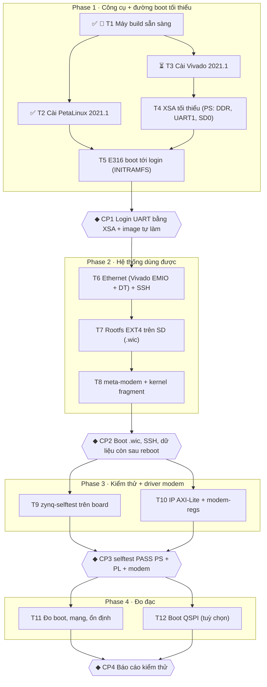

# Lộ trình PetaLinux cho E316

Các bước dựng Linux nhúng cho modem vệ tinh trên ANTSDR E316 **từ đầu**: thứ tự làm, cần cài gì, cần học gì cho từng bước. Task và tiêu chí nghiệm thu chi tiết: [../tasks/todo.md](../tasks/todo.md). Kỹ thuật từng bước build/boot: [quy-trinh-xay-dung.md](quy-trinh-xay-dung.md). Nền tảng: [petalinux.md](petalinux.md), [yocto.md](yocto.md).

| | |
|---|---|
| Công cụ | Vivado 2021.1 ML Standard (chỉ Zynq-7000) + PetaLinux 2021.1, **cùng trên máy build** |
| Máy build | Ubuntu 20.04.6, 12 luồng, 15 GB RAM, chưa có swap |
| Nguyên tắc | Làm từ đầu; `_ZynQ_Study/` chỉ để đối chiếu thông số. Mỗi task là một lát dọc kiểm thẳng trên board |
| Cập nhật | 23/10/2026 |

## 1. Sơ đồ các bước

Ký hiệu: 👤 người dùng làm · ✅ đã xong · ⏳ đang làm · ◆ checkpoint người dùng duyệt.



**Đường găng:** T1 → T3 → T4 → T5 → T6 → T7 → T8. Mốc tối thiểu cho 28/10 là CP2.

## 2. Cần cài

| Nơi | Trạng thái | Chi tiết |
|---|---|---|
| Máy build: gói hệ thống | ✅ xong | `/bin/sh` → bash; 29 gói PetaLinux + 4 gói Vivado; `/opt/pkg`, `/tools/Xilinx` thuộc user; user trong nhóm `dialout` |
| PetaLinux 2021.1 | ✅ xong | `/opt/pkg/petalinux/2021.1` (13 GB) |
| Vivado 2021.1 ML Standard, chỉ Zynq-7000 | ⏳ đang cài | Web installer, token AMD (hạn 30/10/2026), cấu hình `~/.Xilinx/install_config.txt`, tải ~22 GB vào `/tools/Xilinx` |
| Driver cáp JTAG | chưa | Sau khi Vivado xong: `sudo /tools/Xilinx/Vivado/2021.1/data/xicom/cable_drivers/lin64/install_script/install_drivers/install_drivers` |
| Phần cứng | đã có | ANTSDR E316, cáp USB Type-C (console UART1 115200), microSD ≥ 8 GB + đầu đọc, cáp mạng dải 192.168.1.x, jumper boot SD |

Lệnh đã dùng cho máy build (để cài lại trên máy khác):

```sh
sudo dpkg-reconfigure dash          # chọn "No" → /bin/sh là bash
sudo apt update
sudo apt install -y gawk python2 net-tools libncurses5-dev tftpd libssl-dev flex bison \
  git-core diffstat chrpath xterm autoconf libtool texinfo gcc-multilib automake screen pax \
  python3-git python3-jinja2 libegl1-mesa libsdl1.2-dev pylint libtinfo5 zlib1g:i386 \
  picocom device-tree-compiler u-boot-tools \
  libncurses5 default-jre libcanberra-gtk-module
sudo mkdir -p /opt/pkg/petalinux/2021.1 /tools/Xilinx && sudo chown -R "$USER": /opt/pkg /tools/Xilinx
sudo usermod -aG dialout "$USER"    # đăng xuất/nhập lại để có hiệu lực

# PetaLinux
./petalinux-v2021.1-final-installer.run -d /opt/pkg/petalinux/2021.1

# Vivado (web installer)
./Xilinx_Unified_2021.1_0610_2318_Lin64.bin --noexec --target ~/Downloads/xil2021.1
~/Downloads/xil2021.1/xsetup -b AuthTokenGen          # nhập email/mật khẩu AMD
~/Downloads/xil2021.1/xsetup -b ConfigGen             # chọn 2 (Vivado) → 1 (ML Standard), rồi sửa Modules chỉ Zynq-7000:1
~/Downloads/xil2021.1/xsetup -a XilinxEULA,3rdPartyEULA,WebTalkTerms -b Install -c ~/.Xilinx/install_config.txt
```

## 3. Từng bước: làm gì, học gì, xong khi nào

### Phase 1 — Công cụ + đường boot tối thiểu

**T1 · Máy build sẵn sàng** 👤 ✅
- **Làm:** khối lệnh cài gói, thư mục, `dialout`; tải 2 bộ cài; tạo token AMD.
- **Học:** UG1144 v2021.1 chương 2 (yêu cầu host); UG973 (yêu cầu cài Vivado 2021.1).
- **Xong khi:** `readlink -f /bin/sh` ra `/usr/bin/bash`; đủ 33 gói; token tạo thành công.

**T2 · Cài PetaLinux 2021.1** ✅
- **Làm:** chạy bộ cài vào `/opt/pkg/petalinux/2021.1`; mỗi terminal: `source /opt/pkg/petalinux/2021.1/settings.sh /opt/pkg/petalinux/2021.1`.
- **Học:** [petalinux.md](petalinux.md) mục 1–6.
- **Xong khi:** `which petalinux-create petalinux-build petalinux-package` in đủ đường dẫn.

**T3 · Cài Vivado 2021.1** ⏳
- **Làm:** cài batch theo `install_config.txt`; xong thì người dùng cài driver cáp JTAG bằng sudo. Không chạy cùng lúc với `petalinux-build`.
- **Học:** cách mở Vivado (`source /tools/Xilinx/Vivado/2021.1/settings64.sh`), chế độ GUI và chế độ batch Tcl.
- **Xong khi:** `vivado -version` in `v2021.1`; tạo được project rỗng cho `xc7z020clg400-1` bằng Tcl.

**T4 · XSA tối thiểu cho E316 (chỉ PS)**
- **Làm:** viết `hw/e316/create_project.tcl`: block design chỉ có ZYNQ7 PS; DDR3 `MT41J256M16 RE-125` 32-bit; UART1 MIO 12–13; SD0; tắt ngoại vi không dùng. Generate bitstream, Export Hardware kèm bitstream → `hw/e316/system.xsa`. Ghi bảng đối chiếu thông số với thiết kế tham khảo vào `hw/e316/README.md`.
- **Học:** cấu hình ZYNQ7 Processing System (DDR, MIO, clock); Tcl của Vivado (`create_project`, `create_bd_design`, `set_property CONFIG.*`, `write_hw_platform`). Đọc UG585 chương DDR và MIO; UG1165 (Embedded Design Tutorial) phần tạo hệ thống Zynq.
- **Xong khi:** script chạy lại ra cùng XSA; `unzip -l hw/e316/system.xsa` có `.bit`, `ps7_init*`, `.hwh`.

**T5 · E316 boot tới login qua UART (INITRAMFS)**
- **Làm:** `petalinux-create -t project --template zynq -n e316`; `petalinux-config --get-hw-description=../../hw/e316/system.xsa`; console `ps7_uart_1`; `petalinux-build` (lần đầu 1–2 giờ); `petalinux-package --boot …`; chép `BOOT.BIN`, `image.ub`, `boot.scr` lên phân vùng FAT; `picocom -b 115200 /dev/ttyUSB0`.
- **Học:** chuỗi boot Zynq ([petalinux.md](petalinux.md) mục 4; UG585 chương 6); bảng tra lỗi theo log UART ([quy-trinh-xay-dung.md](quy-trinh-xay-dung.md) Phụ lục).
- **Xong khi:** log UART qua FSBL → U-Boot → kernel → login `root`/`root`; 2 nhân; `fpga_manager` ở trạng thái `operating`.

**◆ CP1** — E316 login UART bằng XSA + image tự làm.

### Phase 2 — Hệ thống dùng được

**T6 · Ethernet + SSH**
- **Làm:** Vivado: ENET0 qua EMIO + `gmii_to_rgmii` (FCLK_CLK2 200 MHz) + ràng buộc chân RGMII trong `hw/e316/e316.xdc`. PetaLinux: `system-user.dtsi` cho PHY RTL8211F @ MDIO 1, `phy-mode = "rgmii-id"`, tắt `gmii_to_rgmii_0`, converter `gmiitorgmii@8`; bật dropbear.
- **Học:** EMIO vs MIO; file XDC; Device Tree node PHY/MDIO ([petalinux.md](petalinux.md) mục 9; devicetree.org spec chương 2–3).
- **Xong khi:** `eth0` có link; PC ping và `ssh root@<IP>` vào được.

**T7 · Rootfs EXT4 trên thẻ SD**
- **Làm:** rootfs EXT4, `/dev/mmcblk0p2`, bootargs có `root=/dev/mmcblk0p2 rw rootwait`; `petalinux-package --wic`; `lsblk` trước/sau khi cắm thẻ rồi `dd`.
- **Học:** INITRAMFS vs EXT4; ảnh `.wic` 2 phân vùng; UG1144 “Configuring SD Card ext File System Boot”.
- **Xong khi:** `/` mount ext4 rw; file tạo ra còn sau reboot.

**T8 · Layer `meta-modem` + kernel fragment**
- **Làm:** User Layers thêm `${PROOT}/../../meta-modem`; build lại kernel với `modem.cfg`.
- **Học:** [yocto.md](yocto.md) toàn bộ (layer, recipe, bbappend, cú pháp gatesgarth `_append`, kernel fragment).
- **Xong khi:** mọi option của `modem.cfg` có trong `.config` của kernel; board boot lại bình thường.

**◆ CP2** — Boot từ `.wic`, SSH được, dữ liệu còn sau reboot, kernel có option modem. **Mốc tối thiểu cho 28/10.**

### Phase 3 — Kiểm thử + driver modem

**T9 · `zynq-selftest` trên board**
- **Làm:** bật `zynq-selftest` + ethtool, iperf3, i2c-tools, spitools, mtd-utils, memtester trong rootfs; chạy với `EXPECT_CPUS=2 EXPECT_MEM_MB=<DDR> PING_HOST=<IP PC>`.
- **Học:** thêm gói vào rootfs ([yocto.md](yocto.md) mục 8).
- **Xong khi:** PASS CPU, RAM, kernel log, rootfs, UART, SD, eth0, PL; ép FAIL thì mã thoát ≠ 0.

**T10 · IP AXI-Lite + `modem-regs`**
- **Làm:** Vivado: IP AXI4-Lite (thanh ghi version cố định + scratch) trên GP0, xuất XSA; PetaLinux: node `compatible = "modem,modem-regs"`, bật gói `modem-regs`, `petalinux-package --boot`.
- **Học:** Create and Package IP AXI4-Lite (UG1118); platform driver Linux, `ioremap`, misc device (LDD3 chương 2–3).
- **Xong khi:** `/dev/modem_<địa chỉ>` đọc đúng version, scratch ghi/đọc khớp, truy cập lệch căn lề trả `EINVAL`.

**◆ CP3** — selftest PASS PS + PL + modem.

### Phase 4 — Đo đạc

**T11 · Đo đạc + báo cáo**
- **Làm:** boot time (`printk.time=1`), `iperf3` hai chiều, dung lượng rootfs, RAM trống; chạy ~12 giờ + reboot 20 lần; ghi `docs/test-report.md`.
- **Xong khi:** số đo thật so với mục tiêu README §6.3 (boot < 10 s, iperf3 > 500 Mbit/s, rootfs < 64 MB).

**T12 · Boot QSPI (tuỳ chọn)**
- **Làm:** bật QSPI trong PS, phân vùng flash, `flashcp` `BOOT.BIN`, đổi jumper (cần schematic E316).
- **Xong khi:** `cat /proc/mtd` đúng; boot QSPI tới login.

**◆ CP4** — Đạt tiêu chí README §6 (bản rút gọn).

## 4. Cần học: tổng hợp

“Đã có nền” = đã làm thực tế trong lộ trình học E316; chỉ cần ôn và áp vào dự án.

| Chủ đề | Dùng ở | Mức hiện tại | Đọc gì |
|---|---|---|---|
| Vivado: ZYNQ7 PS, block design, Tcl batch | T4, T6, T10 | Đã có nền · Lab V1 (làm bằng GUI trên Windows) | UG1165; UG585 chương DDR/MIO; UG835 (lệnh Tcl) |
| Quy trình PetaLinux | T5–T10 | Đã có nền · Lab 8 | [petalinux.md](petalinux.md); UG1144 v2021.1 chương 3–5 |
| Chuỗi boot Zynq, BOOT.BIN, U-Boot, FIT | T5, T7, T12 | Một phần · Lab D chưa làm | UG585 chương 6; UG1144 “Packaging and Booting” |
| Device Tree: dtsi, `&label`, PHY/MDIO | T6, T10 | Đã có nền · Lab 8–9 | devicetree.org spec chương 2–3 |
| EMIO + `gmii_to_rgmii` + XDC | T6 | Đã có nền · Lab V1/B2 | UG585 chương Ethernet; PG160 (GMII to RGMII) |
| Rootfs EXT4, ảnh `.wic`, `dd` | T7 | **Mới** · Lab 8 dùng INITRAMFS | UG1144 “Configuring SD Card ext File System Boot” |
| Yocto: layer, recipe, bbappend, gatesgarth | T8–T10 | **Mới** | [yocto.md](yocto.md); Yocto 3.2 Dev Manual |
| Linux driver: platform, ioremap, misc device | T10 | **Mới** | LDD3 chương 2–3, 9; kernel `driver-model/platform.rst` |
| IP AXI4-Lite tự tạo | T10 | Đã có nền · P1 BRAM | UG1118 “Creating and Packaging Custom IP” |

---

Lệnh từ T4 trở đi lấy từ kế hoạch, chưa chạy thử với 2021.1. Tên chương tài liệu ghi theo trí nhớ, cần đối chiếu khi mở. Mọi lệnh `petalinux-*`, Vivado batch và ghi thẻ SD đều hỏi người dùng trước khi chạy.
